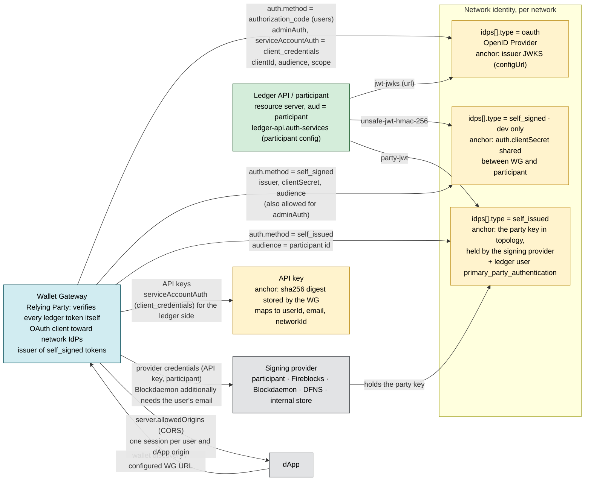
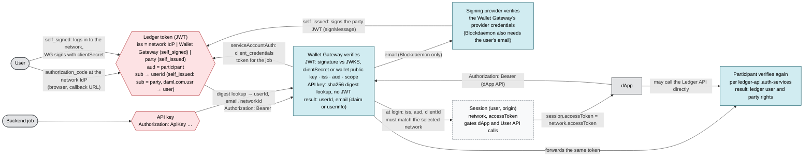

A Wallet Gateway connects users to one or more **networks**. Each network points at a Canton
validator's Ledger API and references an **identity provider** (IDP) that issues the JWT used
to authenticate against that validator. This guide covers both, plus the authentication
methods a network can use.

Networks and IDPs are seeded from the `bootstrap` section on first run. After that, the admin
user (see `server.admin` in [Configure the Wallet Gateway](configure.mdx))
can manage them at runtime through the User API or User UI.

## Who trusts whom

Authentication in a Wallet Gateway deployment involves three identities:

- the **ledger user**, who may use a network's Ledger API and, through it, the Wallet Gateway,
- the **API-key principal**, a backend job the Wallet Gateway maps to a user and a network, and
- the **signing-provider identity**, the credentials the Wallet Gateway holds for each provider.

Each has its own trust anchor and its own verifier. The two views below use OpenID Connect
terminology: the **OpenID Provider** (identity provider, IdP) issues tokens, the **Relying Party**
consumes identity and obtains tokens, and the **resource server** is what a token's `aud` names and
what finally verifies it. Today the Wallet Gateway has no identity of its own: a user logs in to a
network, and that network's token is also the Wallet Gateway session.

<Note>

This section describes the remote (self-hosted) Wallet Gateway. The browser extension trusts the
same anchors and uses the same ledger tokens. It adds one local anchor: sessions, the auth context
and keys live in a vault encrypted with the user's password, so nothing can be used until the
user unlocks it.

</Note>

### Configured trust

This is what configuration establishes before any user logs in; nothing here changes at runtime.
An arrow points **from the component that trusts to the anchor it is configured to trust**, and
the label names the configuration that establishes it. Yellow nodes are anchors (issuers or keys),
blue is a relying party, green is the resource server.



Key points:

- **The validator decides who its users are.** Each network's `auth` must match the participant's
  `ledger-api.auth-services`. The Wallet Gateway cannot grant itself ledger access; it only
  obtains tokens from the anchor the network is configured with.
- **The Wallet Gateway trusts the same anchors.** It is a Relying Party of the network IdP: on
  every request it checks the token's signature with the same JWKS, shared secret or party key,
  plus `iss`, `aud` and the presence of a scope. When a session is created it also checks that
  `iss`, `aud` and `clientId` match the selected network. A token the participant would reject
  therefore never reaches the Wallet Gateway's own APIs either.
- **`self_signed` makes the Wallet Gateway an issuer.** It signs tokens with the network's
  `clientSecret` (`kid` = network id), which is why it is development only.
- **`self_issued` moves the anchor to the party key.** The Wallet Gateway verifies the EdDSA
  signature against the public key of the stored wallet that the token names, and that wallet
  must be marked as the user's authentication party. The signing provider that holds the key is
  part of the ledger trust chain, so the participant signing provider cannot be used for it. See
  [Self-issued access token](self-issued-authentication.mdx).
- **Signing providers have their own identity.** The Wallet Gateway authenticates to each
  provider with the credentials you configure. Some providers also need user attributes:
  Blockdaemon requires an email, which today comes from the ledger token's `email` claim, the
  IdP's `userinfo` endpoint, or the API key record.

### Runtime verification

Once configured, every user or dApp request carries one JWT, the ledger token, and two
components verify it in turn: the Wallet Gateway when the request arrives, and the participant
when the token reaches the Ledger API. Backend jobs present an API key instead and the Wallet
Gateway obtains a ledger token for them. Tokens are stateless; the Wallet Gateway keeps a
`Session` per `(user, dApp origin)` to authorize dApp and User API calls and to hand the token to
the dApp.



#### Tokens at a glance

| Credential | Issued by (`iss`) | Audience (`aud`) | Presented by | Verified by | Anchor (from configuration) |
| --- | --- | --- | --- | --- | --- |
| Ledger token, `authorization_code` / `client_credentials` | Network IdP (`oauth`) | participant | User UI, dApp (`session.accessToken`), Wallet Gateway | Wallet Gateway (signature, `iss`, `aud`, scope), then participant | IdP JWKS (`configUrl`) / `jwt-jwks` |
| Ledger token, `self_signed` | Wallet Gateway (`kid` = network id) | participant | User UI, dApp, Wallet Gateway | Wallet Gateway (HS256 with `clientSecret`, `iss`, `aud`), then participant | `auth.clientSecret` / `unsafe-jwt-hmac-256` (dev only) |
| Ledger token, `self_issued` | the party, signed by the signing provider | participant | User UI, dApp, Wallet Gateway | Wallet Gateway (EdDSA vs the stored wallet's key, `isAuthParty`), then participant | party key in topology / `party-jwt` + `primary_party_authentication` |
| API key | n/a (pre-shared) | Wallet Gateway | Backend job (`Authorization: ApiKey …`) | Wallet Gateway (sha256 digest) | stored key digest; `serviceAccountAuth` (`client_credentials`) for the ledger token |

<Note>

**Planned: a Wallet Gateway identity separate from the ledger identity.** Today the ledger token
doubles as the Wallet Gateway session, so a user cannot log in to the Wallet Gateway without
picking a network, and the email a signing provider needs comes from the network's token.
[wallet#2467](https://github.com/canton-network/wallet/issues/2467) separates the two: users log
in to the Wallet Gateway through its own IdP, then connect to one or more networks, each with its
own ledger token. For dApps, `session.accessToken` and `network.accessToken` carry the same token
today; after the change `session.accessToken` is the Wallet Gateway credential and only
`network.accessToken` is the ledger token. This section will be updated when that lands.

</Note>

## Identity providers

Every network references an IDP by `id`. The Wallet Gateway supports three IDP types: `oauth`,
`self_signed`, and `self_issued`. The first two are described below; for `self_issued`, see
[Self-issued access token](self-issued-authentication.mdx).

<Warning>

Use an **OAuth** IDP for production. Self-signed tokens are for development and testing only.

</Warning>

### OAuth / OpenID Connect

Integrates with an external OAuth 2.0 / OpenID Connect provider to obtain tokens.

- `id` (required): must match the `identityProviderId` referenced by networks.
- `type` (required): `"oauth"`.
- `issuer` (required): the `iss` claim value, matching your provider's configuration.
- `configUrl` (required): the OpenID Connect discovery endpoint, typically
  `${OAuthServerURL}/.well-known/openid-configuration`.

```json
{
    "bootstrap": {
        "idps": [
            {
                "id": "idp-production",
                "type": "oauth",
                "issuer": "https://auth.example.com",
                "configUrl": "https://auth.example.com/.well-known/openid-configuration"
            }
        ]
    }
}
```

### Self-signed

Generates JWTs locally using a secret. Convenient for development, not for production.

- `id` (required): must match the `identityProviderId` referenced by networks.
- `type` (required): `"self_signed"`.
- `issuer` (required): the `iss` claim value, matching what the validator expects.

```json
{
    "bootstrap": {
        "idps": [
            {
                "id": "idp-self-signed",
                "type": "self_signed",
                "issuer": "self-signed"
            }
        ]
    }
}
```
### Identity provider management
This guide is only for parties with administrator access.
1. Select the hamburger icon on the top right and click **Identity Provider**.
2. Review the list of available identity providers.
3. To **add**: click on **+ New** to add a new identify provider.
4. To **edit**: click on an identity provider card to make changes or delete it permanently.


## Networks

A network represents a Canton validator that users can reach through the Wallet Gateway. `networks`
is an array, so you can configure several in one Wallet Gateway.

- `id` (required): unique identifier in [CAIP-2](https://github.com/ChainAgnostic/CAIPs/blob/main/CAIPs/caip-2.md)
  form, for example `"canton:localnet"`.
- `name` (required): a user-friendly name shown in the UI.
- `description` (optional): a description shown to users.
- `synchronizerId` (required): the synchronizer ID used on the validator. For multiple
  synchronizers, configure a separate network per synchronizer.
- `identityProviderId` (required): must match the `id` of a configured IDP.
- `ledgerApi.baseUrl` (required): the base URL of the validator's Ledger API.
- `auth` (required): authentication for normal ledger operations. This is the method users go
  through in the UI.
- `adminAuth` (optional): authentication for admin operations, used by the backend only.

```json
{
    "bootstrap": {
        "networks": [
            {
                "id": "canton:localnet",
                "name": "Local Network",
                "description": "Local development network",
                "synchronizerId": "local",
                "identityProviderId": "idp-self-signed",
                "auth": {
                    "method": "self_signed",
                    "issuer": "self-signed",
                    "audience": "https://canton.network.global",
                    "scope": "openid daml_ledger_api offline_access",
                    "clientId": "ledger-api-user",
                    "clientSecret": "unsafe"
                },
                "ledgerApi": {
                    "baseUrl": "http://localhost:2975"
                }
            }
        ]
    }
}
```

## Authentication methods

A network's `auth` (and optional `adminAuth`) uses one of three methods.

| Method | Use for | Notes |
| --- | --- | --- |
| `authorization_code` | Interactive, user-facing flows | Users grant authorization in their browser. |
| `client_credentials` | Machine-to-machine (production) | Recommended for `adminAuth` and server deployments. |
| `self_signed` | Development and testing | The Wallet Gateway signs tokens locally. |

### authorization_code

```json
{
    "auth": {
        "method": "authorization_code",
        "audience": "https://canton.network.global",
        "scope": "openid daml_ledger_api offline_access",
        "clientId": "my-client-id"
    }
}
```

### client_credentials

```json
{
    "auth": {
        "method": "client_credentials",
        "identityProviderId": "machine-token-idp",
        "audience": "https://canton.network.global",
        "scope": "openid daml_ledger_api offline_access",
        "clientId": "my-service-client",
        "clientSecret": "my-secure-secret"
    }
}
```

`identityProviderId` is optional. When set, the Wallet Gateway uses that OAuth IDP to discover
the token endpoint instead of the network's top-level identity provider. This is useful when user
authentication uses a different IDP than admin authentication.

### self_signed

```json
{
    "auth": {
        "method": "self_signed",
        "issuer": "self-signed",
        "audience": "https://canton.network.global",
        "scope": "openid daml_ledger_api offline_access",
        "clientId": "ledger-api-user",
        "clientSecret": "unsafe-secret-for-development"
    }
}
```

<Warning>

`clientSecret` and `adminAuth` credentials are sensitive. Keep them out of version control and
supply them through environment variables or a secret manager. See the
[Configuration reference](../reference/configuration-reference.mdx#secrets-and-environments).

</Warning>

### `auth` vs `adminAuth`

Each network defines two independent OAuth configurations:

| | `auth` | `adminAuth` |
| --- | --- | --- |
| Typical method | `authorization_code` | `client_credentials` |
| Used by | End users logging into the User UI; ledger reads/writes in normal operation | Background jobs: automatic wallet sync on first login, party allocation |
| Client ID | User-facing OAuth client | Service account / M2M client (often separate) |
| Must match validator | `audience` and scopes must match ledger expectations | Same |

**Can `clientId` be the same?** Yes, if one OAuth client supports both the authorization-code and
client-credentials flows with the right scopes. Many deployments use a dedicated client for `auth`
and either reuse it or use a separate `adminAuth` client; either is valid.

**Does `auth.clientId` need a wallet or party?** No. The client only needs to obtain tokens for
users who already have ledger rights (or will receive them through your IDP).

**When is `adminAuth` required?** For automatic wallet sync when a user logs in and the Wallet
Gateway has no wallets stored yet. Without valid `adminAuth`, `addSession` may fail with HTTP 500.
If you only create wallets manually and never rely on sync, some flows may still call admin APIs,
so configure `adminAuth` unless you know your deployment does not need it.

Store `adminAuth` secrets via `clientSecretEnv` and Kubernetes secrets (Helm `oauthSecrets`)
rather than plain text in config files.

### Service account automation (`serviceAccountAuth`)

To let backend jobs submit transactions with an API key, add a `serviceAccountAuth` block
(machine-to-machine `client_credentials`) to the network. The Wallet Gateway uses it to obtain
ledger tokens when an API key request arrives, so a `prepareExecute` call runs prepare, sign, and
execute straight through. End users still sign in with the network's normal `auth`.

```json
{
    "serviceAccountAuth": {
        "method": "client_credentials",
        "identityProviderId": "machine-token-idp",
        "clientId": "wallet-gateway-automation",
        "clientSecretEnv": "WG_SERVICE_ACCOUNT_CLIENT_SECRET",
        "audience": "https://canton.network.global",
        "scope": "openid daml_ledger_api offline_access"
    }
}
```

See [Service account automations](../automation/service-account-automations.mdx)
for the full setup.

### Network management
This guide is only for parties with administrator access.
1. Select the hamburger icon on the top right and choose **Network**.
2. Review the list of available networks.
3. To **add**: click on **+ New** to add a new network.
4. To **edit**: click on a network card to make changes or delete it permanently.
5. The connected network can be reviewed at the top of the pop-up showing a green dot: [network name] or in the network list with a green `Connected` tag.

## Runtime management

Once the Wallet Gateway is running, the admin user can add, edit, and remove networks and IDPs
without restarting, using the User API (`addNetwork`, `removeNetwork`, `addIdp`, `removeIdp`,
`listNetworks`, `listIdps`) or the **Networks** and **Identity Providers** pages in the User UI. Runtime changes are
stored in the database, so back it up to avoid losing them. See the
[User API](../reference/user-api.mdx) and
[Party management](../use/party-management.mdx).
